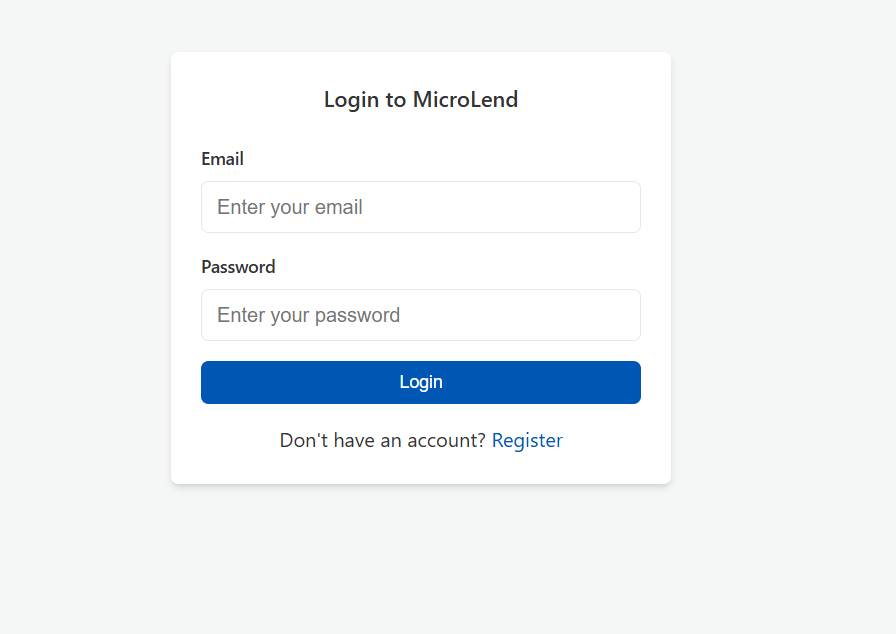
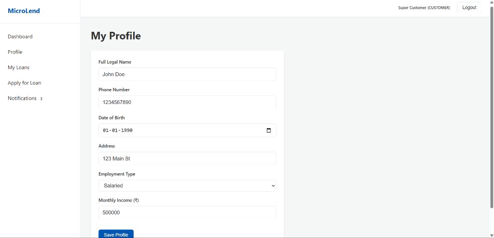
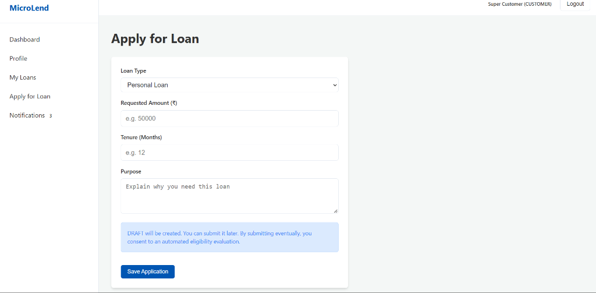
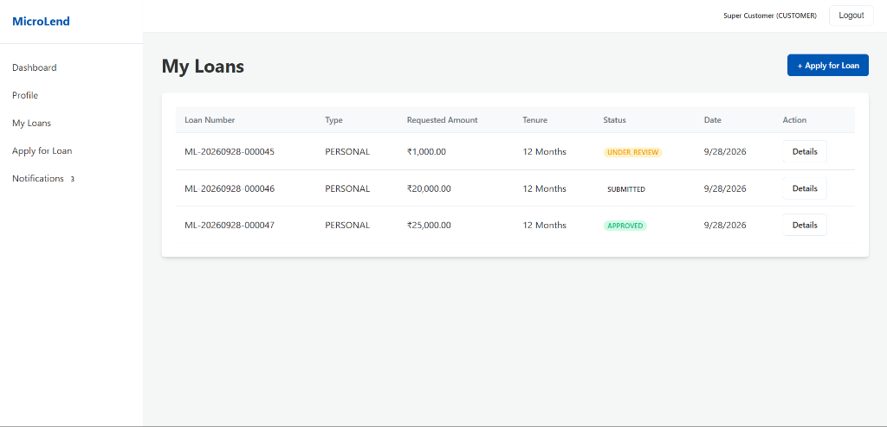
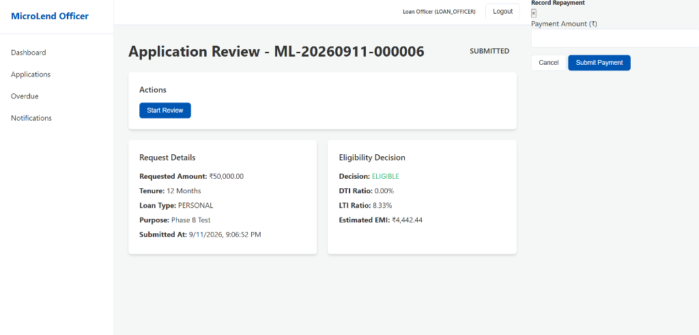

# MicroLend — Loan Management & Eligibility Platform

MicroLend is a complete, monolithic Spring Boot application designed to manage the entire lifecycle of a loan, from customer registration and profile creation to loan application, automated eligibility evaluation, loan officer approval, and final repayment tracking. 

## Key Features
- **Stateless JWT Authentication**: Secure, role-based access control (CUSTOMER vs LOAN_OFFICER).
- **Dynamic Customer Profiles**: Store financial metrics including income and obligations.
- **Automated Eligibility Engine**: Business rules evaluate Debt-to-Income (DTI) and Loan-to-Income (LTI) ratios dynamically against live profile data.
- **Officer Dashboard & Workflow**: Queue management for loan officers to review, approve, or reject applications.
- **Financial Ledger & Repayment Tracking**: Generates exact EMI schedules and tracks disbursements, installments, and penalties.
- **Prepayment & Settlement Quotes**: Calculates live settlement quotes waiving future interest.
- **Event-Driven Notifications**: Asynchronous user notifications for application status changes.

## Technology Stack
- **Backend:** Java 17, Spring Boot 3.3.x (Web, Data JPA, Security)
- **Database:** MySQL 8.x with Hibernate ORM
- **Security:** Spring Security, JSON Web Tokens (JWT)
- **Frontend Integration:** Thymeleaf, Vanilla JS, CSS (fetch API for AJAX)
- **Build Tool:** Maven

## Architecture


The application follows a standard Package-by-Feature (Domain-Driven) architectural pattern, utilizing the classic Controller-Service-Repository layers with DTOs isolating the entity layer from external APIs.

```
src/main/java/com/microlend/
├── auth/           # JWT generation, authentication, and registration filters
├── common/         # Global exception handling and shared utilities
├── customer/       # Customer profile management
├── disbursement/   # Disbursing approved loans
├── eligibility/    # The core business rules engine (DTI, LTI)
├── loanapplication/# Draft, submit, and track applications
├── loanofficer/    # Officer approval/rejection workflows
├── notification/   # Async alerts for users
├── repayment/      # EMI schedules, ledgers, and penalties
├── security/       # Spring Security configs and JWT interceptors
└── user/           # Core user entity and role enum
```

## Workflows

### Authentication Flow


- **Registration/Login:** The `/api/auth/` endpoints authenticate users via `BCryptPasswordEncoder` and generate a JWT.
- **Client Handling:** The frontend saves the JWT to `localStorage` and intercepts all API calls (via a custom `apiFetch` wrapper in `auth.js`) to attach the `Authorization: Bearer <token>` header.
- **Roles:** Handled via Spring Security `@PreAuthorize`. A `CUSTOMER` can only access their own data, while a `LOAN_OFFICER` can access the review queues.

### Loan Application Workflow


1. **DRAFT:** Customer initiates a loan. It is saved as a draft.
2. **SUBMITTED:** Customer submits the loan.
3. **EVALUATION:** Customer manually triggers the Eligibility Engine which pulls their *live* monthly income to determine eligibility.
4. **UNDER_REVIEW:** A Loan Officer picks up the application from their queue.
5. **APPROVED/REJECTED:** The Loan Officer makes a final decision. (Note: The backend strict-checks that a loan *must* have an `ELIGIBLE` evaluation record before approval).
6. **CLOSED:** Upon full repayment or settlement.

### Eligibility Engine Flow


The `EligibilityCalculator` executes the following hardcoded business rules:
- **Minimum Income:** Monthly income must be >= ₹15,000.
- **LTI Ratio (Loan-to-Income):** Requested Amount / (Monthly Income * 12) must be <= 5.0.
- **DTI Ratio (Debt-to-Income):** Existing Monthly Obligations / Monthly Income must be <= 0.50 (50%).
- **Tenure:** Must be between 6 and 60 months.

## Database Design


- Uses JPA `ddl-auto: update` (ensure this is configured for your environment).
- **Optimistic Locking:** The `LoanAmortizationSchedule` uses `@Version` fields to handle concurrent repayment transactions gracefully via `SELECT FOR UPDATE` patterns.

## API Documentation
*(Note: Not all internal endpoints are listed. These represent the primary domain boundaries).*
- `POST /api/auth/register`, `POST /api/auth/login`
- `GET /api/customers/me`, `POST /api/customers`, `PUT /api/customers`
- `POST /api/loan-applications`, `GET /api/loan-applications`, `PUT /api/loan-applications/{id}`
- `GET /api/eligibility/applications/{id}/evaluate`
- `GET /api/loan-officer/queue`, `POST /api/loan-officer/applications/{id}/approve`
- `POST /api/repayments/applications/{id}/pay`

*Swagger/OpenAPI is not currently configured in the project.*

---

## Setup Instructions

### Prerequisites
- JDK 17
- Maven 3.8+
- MySQL Server 8.0+

### Environment Variables
To keep secrets out of source control, this project uses environment variables. Copy the `.env.example` file to configure your local setup.

**Required Variables:**
- `DB_USERNAME` (Your MySQL username, e.g., root)
- `DB_PASSWORD` (Your MySQL password)
- `JWT_SECRET` (A secure 256-bit base64 encoded string)
- `JWT_EXPIRATION` (Token validity in ms, e.g., 86400000 for 24h)

### Running the Project

1. **Database Setup:**
   Create a database in MySQL named `microlend`:
   ```sql
   CREATE DATABASE microlend;
   ```
2. **Start the Application:**
   Run the Spring Boot application, passing in your environment variables:
   ```bash
   # Windows PowerShell Example
   $env:DB_USERNAME="root"
   $env:DB_PASSWORD="your_password"
   $env:JWT_SECRET="your_secret_key"
   $env:JWT_EXPIRATION="86400000"
   mvn spring-boot:run
   ```
3. **Access the Application:**
   Navigate to `http://localhost:8081` in your browser.

## Screenshots











## Current Limitations & Future Improvements
- **UI Architecture:** The project currently includes an unused `frontend/` React folder, while the active UI is built with Thymeleaf/Vanilla JS. This could be decoupled into a pure REST/React architecture in the future.
- **Hardcoded Rules:** Eligibility thresholds (e.g., minimum income) are currently hardcoded constants in `EligibilityCalculator.java`. Extracting these to a database configuration table would allow dynamic updates without recompilation.

## Author
*Built as a professional portfolio project demonstrating domain-driven backend architecture in Spring Boot.*
